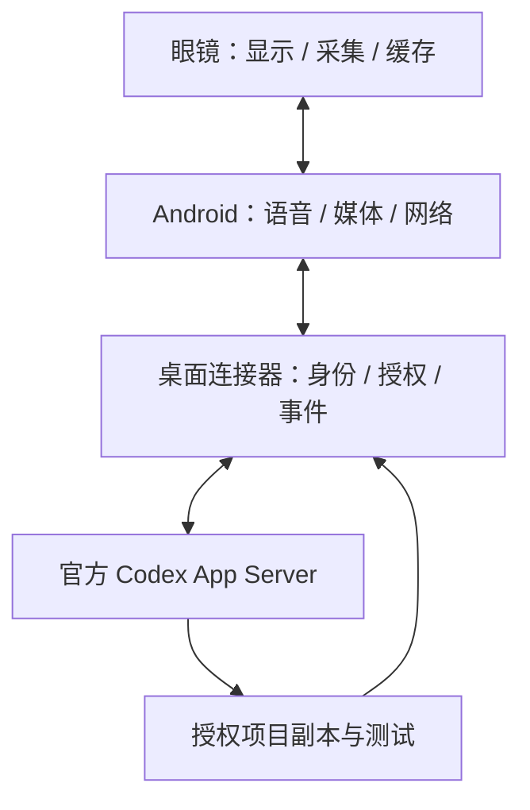

# AgentGlass

**把镜片信息显示、语音交互、第一视角采集与电脑智能体任务连接起来。**

> **本项目仅允许个人非商业学习、研究、修改及自用。未经著作权人事先书面许可，严禁将本项目原创成果用于商业用途，包括商业销售、生产销售、商业集成、商业授权或其他以商业利益为目的的使用。违者必究。**
>
> **商业授权联系邮箱：3277681859@qq.com** · [个人自用与商业授权](COMMERCIAL-LICENSE.md) · [完整许可证](LICENSE)


[English](README_EN.md) · [产品对比](docs/product-comparison.md) · [设计图与资料总索引](docs/design-index.md) · [使用指南](docs/user-guide.md) · [验证记录](docs/verification-report.md)

AgentGlass是一套面向开发者的智能眼镜平台。它将眼镜端固件、Android应用、可自托管的桌面连接器、共享协议和硬件设计资料放进同一个仓库，围绕“说出需求、批准任务、查看真实进度、接收结果”组织交互。

## 为什么是 AgentGlass

| 核心特色 | 用途 | 仓库入口 |
|---|---|---|
| **随身开发任务入口** | 检查项目、修复问题、运行测试；显示连接电脑、项目、任务阶段与结果 | [官方Codex适配](agent-integration/codex/README.md) |
| **面向信息的HUD** | 时间、通知、转写、AI文字与任务状态；手机完成中文栅格化 | [固件与HUD](firmware/README.md) |
| **采集与本地缓存** | 摄像、短录像、录音、媒体校验、确认后删除及断点上传 | [固件](firmware/) / [手机](mobile/README.md) |
| **自己掌握连接器** | 设备绑定、证书核验、项目授权、本机审批及日志事件 | [桌面端](desktop/agentglass/) / [协议](agent-integration/protocols/protocol.md) |
| **从设计到代码可审查** | KiCad、STEP/STL、OpenSCAD、BOM、装配资料、测试与演示 | [设计总索引](docs/design-index.md) |

## 看见并控制真实任务

“检查这个项目有没有Bug” → 选择授权电脑和项目 → 电脑本机批准 → 智能体工作 → HUD显示实际事件和结果。后续fix/test任务可关联会话，取消与断线恢复有明确状态。



模型密钥留在电脑端，任务进度取自可获取的会话事件。回合完成与独立测试验收分别记录。[架构说明](docs/architecture.md)与[安全设计](SECURITY.md)提供具体实现。

## 与市面上产品相比，聚焦在哪里

| 产品 | 核心定位 | 公开显示/交互特点 |
|---|---|---|
| **AgentGlass** | 可审查、可自托管的智能体眼镜平台 | H1单目HUD设计；P1近眼显示适配；自有项目上的inspect/fix/test、真实任务事件与本机审批 |
| **Ray-Ban Meta Gen 3** | 日常拍摄与语音AI | Camera + Audio型号；第一视角记录、通话与日常助手 |
| **Meta Ray-Ban Display** | 带镜片显示的消费AI眼镜 | 单目全彩600×600；消息、字幕、导航与腕带交互 |
| **Rokid Glasses with Display** | 轻量翻译与信息显示 | MicroLED、30°FOV；字幕、翻译、提词与拍摄 |
| **Even Realities G2** | 字幕与信息辅助 | 双目绿光640×350、27.5°FOV；轻量信息提示、沟通辅助 |
| **Brilliant Halo** | 可编程AI眼镜 | 彩色近眼显示；可编程应用与个人AI体验 |
| **XREAL One Pro** | 空间大屏与外部主机显示 | MicroOLED、57°FOV；电脑/游戏/移动设备大屏 |
| **RayNeo X3 Pro** | 全彩AI与空间AR | 双目全彩640×480、30°FOV；导航、翻译、空间应用 |

对比公开定位与接口；厂商规格、项目设计预算和软件验证分别注明。完整来源、参数口径及可机读表见[产品比较](docs/product-comparison.md)。

## 两条硬件路径，一套软件链路

| 配置 | 用途与资料 |
|---|---|
| H1 | 集成镜架的光学、结构、质量和功耗设计；[结构CAD](hardware/mechanical/) / [光学](hardware/optics/) / [预算](hardware/power/) |
| D0 + P1 | D0提供摄像/音频/缓存开发台架；P1使用T-Glass V2近眼显示设备；[接线](hardware/assembly/d0-wiring.csv) / [P1显示](hardware/optics/p1-tglass-v2.md) |

参数按用途给出：H1的66.45g与定义混合负载8.486h是工程预算；P1显示配置单独记录。对应输入、测试范围和证据在[验证报告](docs/verification-report.md)及[证据索引](docs/evidence-index.json)。

## 快速运行

```bash
python -m venv .venv
# 激活虚拟环境后：
python -m pip install -e .
python simulator/demo.py
python scripts/verify.py
```

演示使用真实本机HTTPS完成绑定、审批、任务事件及媒体传输，智能体标注SIMULATOR。公开样例的真实Codex/本地模型复现见[本地模型实验](agent-integration/codex/local-benchmark.md)。

```bash
agentglass --state runtime init --host 电脑私网IP --name 我的开发电脑
agentglass --state runtime project-add demo examples/demo-project --allow-snapshot-writes
agentglass --state runtime serve --simulate
```

Android调试APK与Python wheel位于[releases](releases/README.md)。固件构建入口：`python scripts/build_firmware.py`；Android构建入口：`python scripts/build_android.py --sdk 官方SDK目录`。

## 从这里找到全部资料

- [设计、原理图、PCB、CAD与BOM总索引](docs/design-index.md)
- [产品需求](docs/product-requirements.md) / [架构比较](docs/architecture.md) / [工程计算](docs/feasibility-study.md)
- [市场研究：16款产品](docs/market-research.md) / [产品对比](docs/product-comparison.md) / [资料来源](docs/sources.md)
- [装配与制造资料](docs/manufacturing-guide.md) / [使用指南](docs/user-guide.md)
- [测试记录](docs/verification-report.md) / [38项验收用例](docs/acceptance-matrix.csv) / [安全设计](SECURITY.md)
- [修改与贡献](CONTRIBUTING.md) / [更新记录](CHANGELOG.md) / [GitHub发布说明](scripts/publish-github.md)

本次公开源码发布沿用v0.2软件与固件版本。已有记录包括62项主机测试、API26模拟器运行、两个固件目标交叉编译与公开样例的真实模型修复；证据均保留原执行日期和范围。

原创材料采用**个人非商业源代码可查看许可证**。第三方条款保留，见[NOTICE.md](NOTICE.md)。商业合作请联系 **3277681859@qq.com**。
