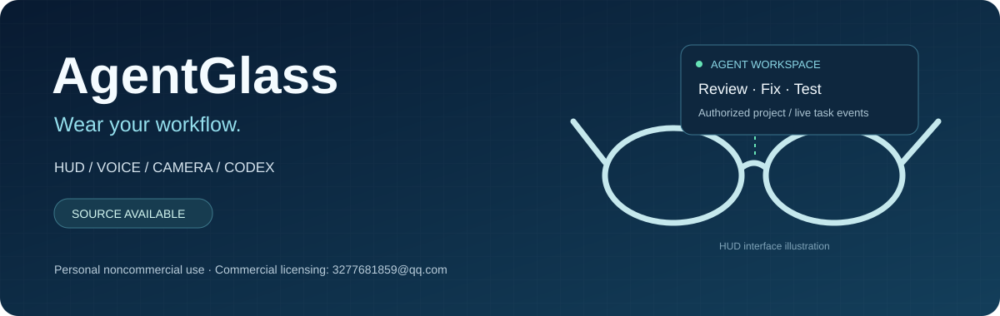

# AgentGlass

**Connect in-lens information, voice, first-person capture and tasks on your own development computer.**

> **Personal noncommercial use only.** Original project material may be used for personal noncommercial learning, research, modification and self-use. Commercial sale, production for sale, integration, licensing, business operations and other commercial uses require the copyright owner's prior written permission. Unauthorized commercial use is prohibited.
>
> **Commercial licensing: 3277681859@qq.com** · [Use policy](COMMERCIAL-LICENSE.md) · [Full license](LICENSE)



[中文](README.md) · [Product comparison](docs/product-comparison.md) · [Design index](docs/design-index.md) · [Evidence](docs/verification-report.md)

AgentGlass brings ESP32-S3 firmware, an Android companion, a self-hosted desktop connector, shared protocols and hardware design material into one repository. Its focus is a developer workflow: speak a request, select an authorized project, approve the task on the computer, observe actual task events and receive a result.

## Practical features

- **Agent workflows:** inspect/fix/test requests, linked sessions, cancellation, public progress events and result summaries through the official Codex App Server adapter.
- **HUD:** time, notifications, transcripts, AI text and task information; Android rasterizes text for the device display.
- **Capture and media:** camera/audio firmware, local cache, SHA-256 checks, acknowledgment and idempotent resumable uploads.
- **Owner-controlled connector:** authenticated pairing, certificate pinning, authorized project snapshots and local operator approval.
- **Editable engineering material:** KiCad, PCB review outputs, STEP/STL, OpenSCAD, BOMs, wiring, assembly documents and validation records.

## Positioning alongside other glasses

Consumer platforms such as Ray-Ban Meta, Meta Ray-Ban Display and Rokid emphasize everyday capture, assistance, captions and navigation. Even G2 focuses on information assistance. XREAL One Pro emphasizes an external large-screen experience, RayNeo X3 Pro combines AI and spatial AR, and Brilliant Halo offers a public developer ecosystem. AgentGlass focuses on owner-controlled project tasks and the complete, inspectable connector workflow. [Sources and comparison data](docs/product-comparison.md) distinguish vendor specifications from project design inputs and software tests; unspecified vendor capabilities are not treated as unsupported.

## Run the software

```bash
python -m pip install -e .
python simulator/demo.py
python scripts/verify.py
```

The HTTPS demo explicitly uses a simulated agent. A real local-model public-fixture reproduction is documented in [the benchmark guide](agent-integration/codex/local-benchmark.md). Android APK and Python wheel packages are in [releases](releases/README.md).

H1 is the integrated-frame design track; D0 is the capture/audio bench target and P1 is the T-Glass V2 near-eye display target. H1's 66.45g and 8.486h defined mixed-use figures are engineering budgets; P1 has separate display parameters. [Evidence records](docs/evidence-index.json) retain test dates and scope, including 62 host tests, an API26 emulator run, two firmware builds and real local-model fixture repairs.

## Repository guide

[Design files](docs/design-index.md) · [Architecture](docs/architecture.md) · [Manufacturing material](docs/manufacturing-guide.md) · [User guide](docs/user-guide.md) · [Protocol](agent-integration/protocols/protocol.md) · [Security](SECURITY.md) · [Contributing](CONTRIBUTING.md) · [Changelog](CHANGELOG.md)

This is a **source-available personal-noncommercial license**, not an OSI-approved open-source license. Third-party materials keep their original terms in [NOTICE.md](NOTICE.md). Legal copyright-owner name: **TO BE COMPLETED BY THE PROJECT OWNER**. Commercial contact: **3277681859@qq.com**.
