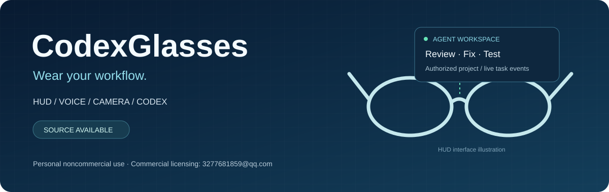
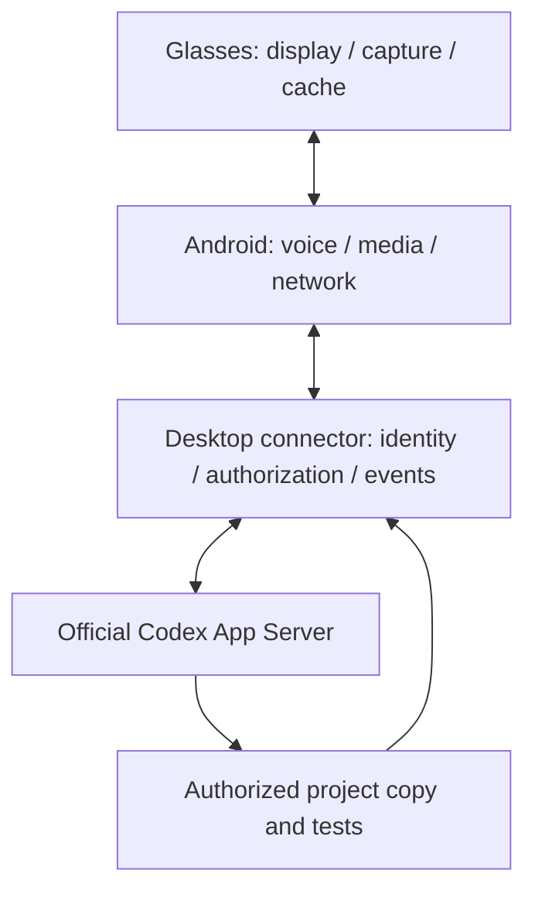

# CodexGlasses

**Put them on and go for a walk. The computer at home keeps working.**

Say "check that project and run the tests" before you leave. The request lands on
Codex or DSH running on your own machine, inside an offline worker, against a copy of
the project you authorized — never the original. Glance at the lens on the way:
connected, which repo, reading files, test 3 of 12, where it got stuck.
You come home with the result already on the glass.

> **Personal noncommercial use only.** Original project material may be used for personal noncommercial learning, research, modification and self-use. Commercial sale, production for sale, integration, licensing, business operations and other commercial uses require the copyright owner's prior written permission. Unauthorized commercial use is prohibited.
>
> **Commercial licensing: 3277681859@qq.com** · [Use policy](COMMERCIAL-LICENSE.md) · [Full license](LICENSE)



[中文](README.md) · [Product comparison](docs/product-comparison.md) · [Design index](docs/design-index.md) · [User guide](docs/user-guide.md) · [Verification record](docs/verification-report.md)

CodexGlasses is a smart-glasses platform for developers. It brings ESP32-S3 firmware,
an Android companion, a self-hosted desktop connector, the shared protocols and the
hardware design material into one repository, organized around one loop:
**speak a request, approve the task, watch real progress, receive the result.**

## A walk, four things

| You | The glasses | The computer at home |
|---|---|---|
| Say one sentence before leaving | Transcribe the speech, send it up | Waits for your click to approve |
| Walk along the lake | Show "connected · which project · which stage" | Runs inspect / fix / test on a project copy |
| Stop and look | Events scroll past: reading files, running tests, which one failed | Real output — not a spinner that says "thinking" |
| Walk back home | Result and verification status | Keeps the record, ready for the next round |

Approval still happens on the computer. You can now say "approve" and let the
transcript do it — or walk back in and click. Voice approval is **off by default**;
enable it in the desktop config. A phrase that is not recognized does nothing at all.

## Which agents it drives: Codex and DSH

Both agents follow one path: **glasses → phone → desktop connector → offline worker → agent CLI**.
Model keys stay on the computer, task progress comes from real session events, and the
container has no outbound network.

| Agent | How it connects | Status |
|---|---|---|
| **Codex** (official App Server) | official JSONL stdio inside an offline Docker worker | wired against the schema measured on CLI 0.162.1; init and config read work, `thread/start` not finished (see [integration notes](agent-integration/codex/README.md)) |
| **DSH** (DeepSeek Harness) | the same worker, a different command line | entry point in place (`CODEXGLASSES_AGENT` / `CODEXGLASSES_AGENT_ARGS`), **not tested against a real DSH** (see [DSH notes](agent-integration/dsh/README.md)) |

Switching agents needs no code change:

```bash
# default: Codex, unchanged when these are unset
CODEXGLASSES_AGENT=dsh CODEXGLASSES_AGENT_ARGS="<dsh args>" \
python3 agent-integration/codex/worker_entry.py
```

What the DSH side must provide (frame format, model endpoint, read/write boundary) is
listed in [agent-integration/dsh/README.md](agent-integration/dsh/README.md). If it has
not run, it is not written up as "supported".

## Issues and stars are welcome

This is a personal project, but it only gets better when someone uses it and argues with it.

- **Broken or insecure?** Open an [issue](https://github.com/miaoyhcat/codex-glasses/issues/new/choose)
  with your OS, Python version, the step you reached and the error you saw.
  A reproducible report is worth the most.
- **Missing a feature?** Also an issue — describe the problem you actually need solved,
  not just "add an X".
- **Think it is interesting?** A [star](https://github.com/miaoyhcat/codex-glasses)
  is the most direct signal that someone is watching.

Licensing stays personal-noncommercial; for commercial use, get in touch first.

## Why CodexGlasses

| Core property | What it is for | Where it lives |
|---|---|---|
| **A dev-task entry point you carry** | Inspect a project, fix it, run tests; show connection, project, task stage and result | [Codex](agent-integration/codex/README.md) · [DSH](agent-integration/dsh/README.md) |
| **An information-first HUD** | Time, notifications, transcripts, AI text and task state; the phone rasterizes Chinese for the display | [Firmware and HUD](firmware/README.md) |
| **Capture with a local cache** | Camera, short video, audio, media verification, delete-after-confirmation and resumable upload | [Firmware](firmware/) / [Phone](mobile/README.md) |
| **A connector you control** | Device binding, certificate verification, project authorization, local approval and log events | [Desktop](desktop/codexglasses/) / [Protocol](agent-integration/protocols/protocol.md) |
| **Reviewable from drawing to code** | KiCad, STEP/STL, OpenSCAD, BOMs, assembly material, tests and demos | [Design index](docs/design-index.md) |

## See and steer the real task

"Check this project for bugs" → pick the authorized computer and project → approve on that
computer → the agent works → the HUD shows actual events and the result. Follow-up fix/test
tasks can be linked to a session; cancellation and reconnect recovery each have defined states.



Model keys stay on the computer; progress comes from real session events. Turn completion
and independent test verification are recorded separately. Implementation details are in
[architecture](docs/architecture.md) and [security design](SECURITY.md).

## Where the focus sits, next to consumer glasses

| Product | Core positioning | Public display / interaction traits |
|---|---|---|
| **CodexGlasses** | Auditable, self-hosted agent-glasses platform | H1 monocular HUD design; P1 near-eye display adaptation; inspect/fix/test on your own projects, real task events and local approval |
| **Ray-Ban Meta Gen 3** | Everyday capture and voice AI | Camera + Audio models; first-person recording, calls and a daily assistant |
| **Meta Ray-Ban Display** | Consumer AI glasses with an in-lens display | Monocular full colour 600×600; messages, captions, navigation and wristband input |
| **Rokid Glasses with Display** | Lightweight translation and information display | MicroLED, 30° FOV; captions, translation, teleprompter and capture |
| **Even Realities G2** | Captions and information assistance | Binocular green 640×350, 27.5° FOV; light information prompts and communication support |
| **Brilliant Halo** | Programmable AI glasses | Colour near-eye display; programmable apps and personal AI experiences |
| **XREAL One Pro** | Spatial large screen and external host display | MicroOLED, 57° FOV; big screens for computers, games and mobile devices |
| **RayNeo X3 Pro** | Full-colour AI and spatial AR | Binocular full colour 640×480, 30° FOV; navigation, translation and spatial apps |

The comparison covers public positioning and interfaces; vendor specifications, project design
budgets and software verification are noted separately. Full sources, measurement conventions
and a machine-readable table are in [product comparison](docs/product-comparison.md).

## Two hardware paths, one software chain

| Configuration | Purpose and material |
|---|---|
| H1 | Optical, mechanical, mass and power design for an integrated frame; [structure CAD](hardware/mechanical/) / [optics](hardware/optics/) / [budget](hardware/power/) |
| D0 + P1 | D0 is the camera/audio/cache bench target; P1 uses the T-Glass V2 near-eye display; [wiring](hardware/assembly/d0-wiring.csv) / [P1 display](hardware/optics/p1-tglass-v2.md) |

Figures are given by purpose: H1's 66.45 g and 8.486 h under a defined mixed load are
engineering budgets; P1 display parameters are recorded separately. Inputs, test scope and
evidence are in the [verification report](docs/verification-report.md) and
[evidence index](docs/evidence-index.json).

## Run it

```bash
python -m venv .venv
# after activating the environment:
python -m pip install -e .
python simulator/demo.py
python scripts/verify.py
```

The demo runs real local HTTPS through pairing, approval, task events and media transfer;
the agent is labelled SIMULATOR. Reproducing the public example with a real Codex or local
model is documented in [the local benchmark](agent-integration/codex/local-benchmark.md).

```bash
codexglasses --state runtime init --host <computer LAN IP> --name "My dev computer"
codexglasses --state runtime project-add demo examples/demo-project --allow-snapshot-writes
codexglasses --state runtime serve --simulate
```

The Android debug APK and the Python wheel are in [releases](releases/README.md).
Firmware build entry: `python scripts/build_firmware.py`; Android build entry:
`python scripts/build_android.py --sdk <official SDK directory>`.

## Where to find everything

- [Design, schematics, PCB, CAD and BOM index](docs/design-index.md)
- [Product requirements](docs/product-requirements.md) / [Architecture](docs/architecture.md) / [Engineering calculations](docs/feasibility-study.md)
- [Market research: 16 products](docs/market-research.md) / [Product comparison](docs/product-comparison.md) / [Sources](docs/sources.md)
- [Assembly and manufacturing](docs/manufacturing-guide.md) / [User guide](docs/user-guide.md)
- [Test record](docs/verification-report.md) / [38 acceptance cases](docs/acceptance-matrix.csv) / [Security design](SECURITY.md)
- [Contributing](CONTRIBUTING.md) / [Changelog](CHANGELOG.md) / [Publishing notes](scripts/publish-github.md)

This public source release keeps the v0.2 software and firmware version. Existing records cover
62 host tests, an API26 emulator run, cross-compilation of two firmware targets, and a real
local-model fixture repair on the public example; each record keeps its original execution date
and scope.

Original material is under a **personal-noncommercial source-available license**. Third-party
terms are preserved in [NOTICE.md](NOTICE.md). Commercial enquiries: **3277681859@qq.com**.

> The deeper engineering records (protocol spec, hardware documents, evidence notes) are written
> in Chinese. This file and the repository guide above are the English entry point; open an issue
> if a specific document matters to you and needs translating.
