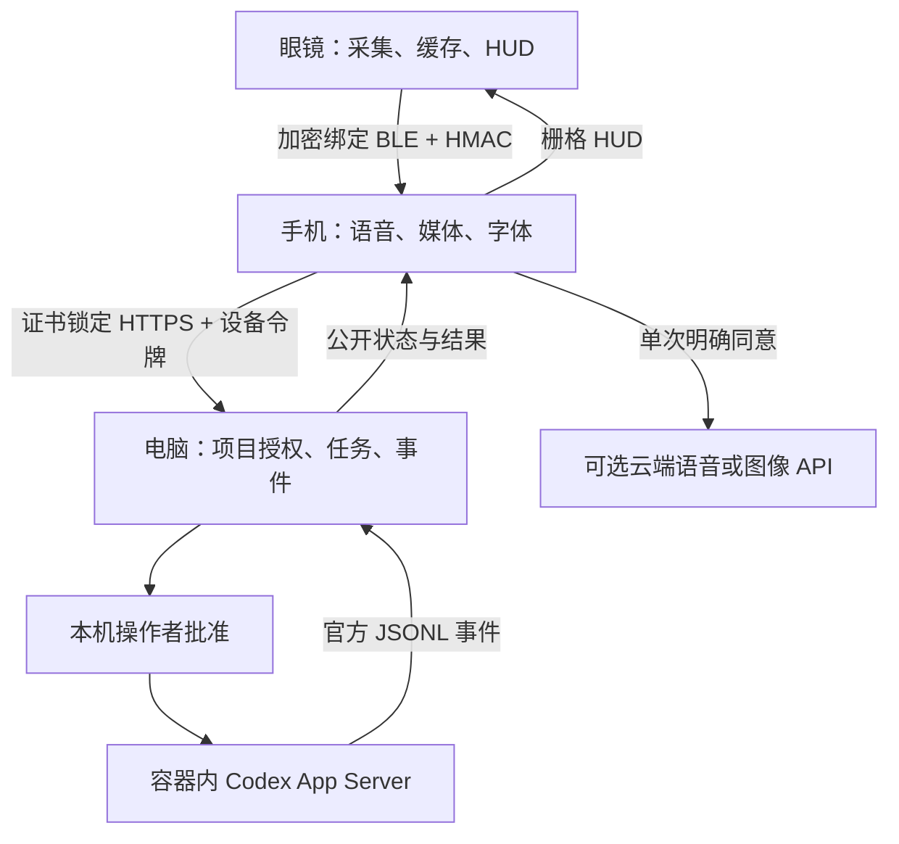
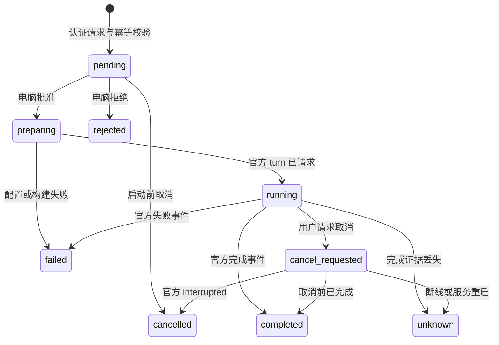

# 系统架构与数据流

H1 为目标整机，D0 是已实现的驱动台架。下面的边界适用于协议和软件；H1 光机、电源管理和无线大文件路径仍未完成实物适配。

原项目只有电脑端可信的 project ID 映射，不由手机上传路径。启动时复制普通文件到独立副本；inspect只读，fix/test可写副本。后续任务携带 `parent_task_id`，必须属于同一项目且上次已完成，复用同一副本并通过 `thread/resume` 恢复上下文。每一步仍需本地批准，同一副本只允许一个活动任务。容器会话状态持久化在私有状态目录，认证文件另行只读挂载。

UI使用的是事件阶段、工具项目生命周期、退出码、公开计划和最终用户可见消息。没有基于时间的百分比，没有转发 reasoning，也不会把“进程还活着”显示成“模型正在思考”。断线恢复首先续读事件；状态unknown的任务不能自动重放或按成功处理。

## 存储与媒体

眼镜先写 `.part`，flush 后重命名为JPEG/WAV/AGMJ文件，再发布ID、长度和SHA-256。手机按offset读取，成功落盘并核验后才发ack；眼镜只有在ack哈希相同后才能删除本地副本。手机到电脑是独立的顺序分块上传、精确重传、完整性提交。两层缓存不能共用一个“收到蓝牙包就删除”的确认。

AGMJ是本项目的JPEG帧容器，含原始时间戳；用 `scripts/extract_agmj.py` 解出帧和CSV。它不伪称为浏览器可直接播放的H.264/MP4。容量不足时明确报错，不覆盖未确认媒体。

## 计算分配

| 位置 | 承担 | 明确不承担的目标部分 |
|---|---|---|
| H1 MCU | 实时外设、缓存、按键、连接、状态HUD、电源调度 | 不在S3上运行大型多模态模型或Codex |
| 手机 | 中文字体栅格、系统ASR/TTS、持久媒体、通知、TLS中转 | 不持有电脑operator令牌或Codex高权限认证 |
| 电脑桥 | 本地批准、项目副本、真实状态、审计、API网关 | 无任意远程shell/任意路径执行接口 |
| Codex容器 | 获授权副本的智能体任务与会话 | 不挂载宿主家目录、原项目或Docker socket |
| 可选模型API | 明确同意的短语音和单张图像 | 默认不开启；不使用Codex订阅令牌冒充API密钥 |

局域网发现暂以手工地址与证书指纹完成；未实现mDNS/二维码和跨互联网自动穿透。互联网接入计划使用个人VPN私网而非公开App Server端口，仍必须保留应用认证和TLS。iOS目前只有同源网页工作台入口，没有原生BLE/媒体/通知应用。

## v0.2修订：当前优先试制与凭据边界

P1为当前可采购验证分支：完整T-Glass V2/H715接手机第二条BLE显示链，D0独立承担采集台架。H1仍是集成产品目标，原候选排名不是所有制造门槛已通过的结论。

电脑持有模型API密钥，真实worker采用--network=none；官方RPC与受限模型流通过stdio的不同通道复用。只给worker短期任务令牌，不再挂载长期账户认证。固定模型、限额、拒绝托管工具/外部状态/远程文件引用的测试已通过，实际Docker边界待验。模型回合completed与独立verification_status分离；默认未验收。
