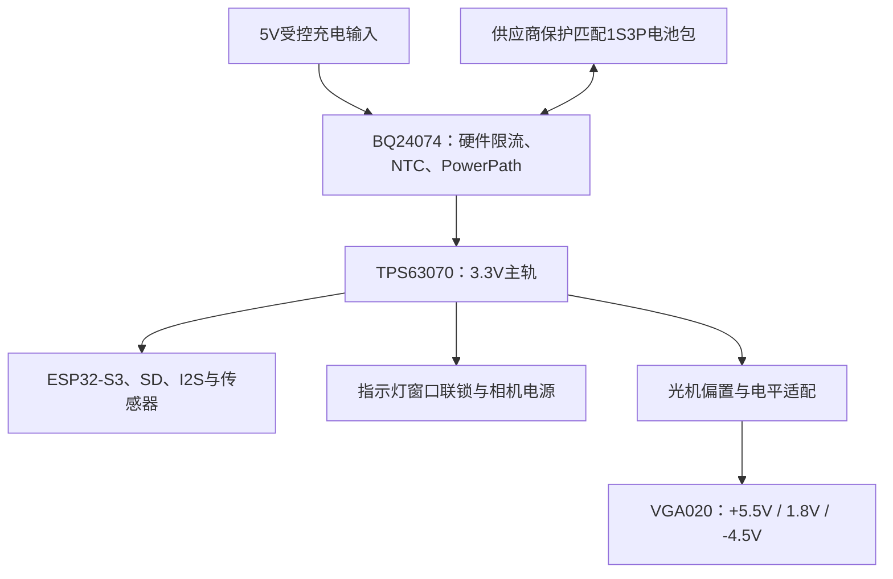

# H1 电源树与电气约束

这是设计约束，不是已经完成布线/验证的整机电源板。

BQ24074候选用硬件电阻限制约100mA初始充电，避免MCU未启动时出现过大默认电流。具体ISET电阻、输入限流、定时器和NTC网络须按选定电芯包、温区和数据手册公差定版，未发布虚假的最终电阻值。电池本身还需过充、过放、短路/过流保护；充电器不替代包保护板。

目标充电窗口0–45°C，来自所选电芯供应商范围；应按NTC误差留边界。禁止佩戴时进行未验证的充电热试验。优先磁吸低压触点/充电盒；触点反接、汗液腐蚀、短路及触摸可达性尚需设计验证。没有使用裸电芯自行串/并接的装配步骤。

主轨按单节低电压校核峰值，不用转换器开关电流直接等同输出能力。Wi-Fi发送、SD写入、相机启动和扬声器输出需互斥/限额调度。500mA以上的电源阶跃试验、输入下陷、brownout、负载断开和射频瞬态必须在实物测量。

VGA020HW02C不是3.3V即插即用模块。TPS65132系列可提供所需正负轨范围，TLV75518候选供1.8V逻辑；是否满足精确电流/启动顺序/纹波仍需光机供应商完整资料。QSPI需电平转换和方向控制，不能把3.3V GPIO直接接到未经确认的1.8V输入。H1完整引脚重分配尚未完成，D0 SPI LCD引脚不等于H1 QSPI引脚。

## D0 指示灯测试板

独立3.3V试验coupon：外部主开关给比较器和相机供电；REQ先给可见LED支路供电，MCP6547检测LED节点是否位于约1.0–2.7V，满足窗口才允许TPS22918上电。LED开路或短路时把ON拉低；REQ为低则LED与相机均关闭。REQ经10k连接ON，ON有100k下拉。GPIO必须能够安全提供正常LED电流及短路试验时约10mA的受限电流，必要时使用缓冲驱动并重新核对时序。TPS22918引脚按VIN1、GND2、ON3、CT4、QOD5、VOUT6绘制；QOD接输出以放电。

该电路检测**电气开路/短路**，不能检测LED被胶带遮住、光强不足、散射角不合格、部分退化或IO反向供电。DVP/SCCB/XCLK信号需要另行隔离/掉电高阻方案。因此它是用于验证联锁想法的测试板，尚不是完整相机隐私安全设计。
